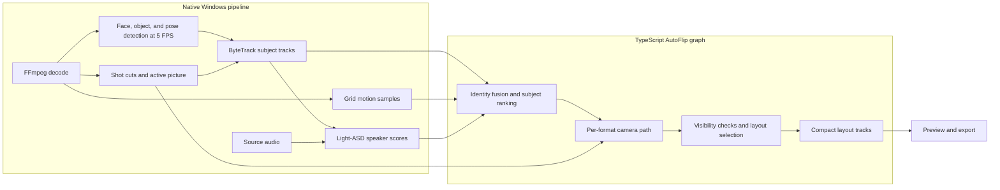

<p align="center">
  <a href="https://grepcut.com/en/open-clipper">
    
  </a>
</p>

<h1 align="center">Open Clipper</h1>

<p align="center">
  AI-powered video clipping and publishing by <a href="https://grepcut.com/">GrepCut</a>.
</p>

<p align="center">
  <a href="https://grepcut.com/en/open-clipper"><strong>Download for Windows</strong></a>
  | <a href="#features">Features</a>
  | <a href="#developing-from-source">Developer setup</a>
</p>

<p align="center">
  <a href="https://grepcut.com/en/open-clipper"></a>
  <a href="https://grepcut.com/"></a>
  <a href="https://grepcut.com/discord"></a>
  <a href="https://x.com/GrepCut"></a>
  
  <a href="LICENSE"></a>
</p>

Open Clipper is a free, open-source Windows desktop app for turning long videos from YouTube or local files into short, platform-ready clips. Transcribe with local Whisper or Parakeet or with a cloud provider, reframe around subjects and scene cuts, style captions, and export clips in batches. Publish directly to TikTok and YouTube, or export files for Instagram, Facebook, X, and other platforms.

> [!TIP]
> **Just want to use the app? Download the Windows installer.**
>
> Get the `.exe` from **[grepcut.com/en/open-clipper](https://grepcut.com/en/open-clipper)** and run it.
>
> To contribute or change the code, follow [Developing from source](#developing-from-source).

## Features

### Start with a YouTube link or a local file

Choose **Import from YouTube**, paste a link to a video or Short, confirm permission, and click **Download video**. Click **Continue** after the download, then select the range you want to clip. You can also start with a local file.

### Local and cloud transcription

| Where it runs | Available models |
| --- | --- |
| On your PC | Parakeet TDT 0.6B v3, Whisper Large v3 Turbo |
| Groq | Whisper Large v3, Whisper Large v3 Turbo |
| OpenRouter | Whisper Large v3 Turbo |

Cloud transcription uses your own Groq or OpenRouter API key. By default, MDX isolates vocals on your PC before a fresh transcription to help reduce errors caused by background music. This runs for local transcription and on the audio prepared for upload to cloud providers.

[processing.webm](https://github.com/user-attachments/assets/1c0a85bc-8891-4638-89ec-622f351b18a5)

### Automatic or manual clips

**Auto-parts** splits the selected range into consecutive clips. Choose a target length of 15, 30, 45, or 60 seconds, or set a custom length from 5 to 180 seconds. The app aligns cut points to video keyframes when available, so clip durations can vary around the target. Turn on the optional overlay to number clips with labels like `Part 1` and `Part 2`.

Use **Manual** to pick ranges yourself or **MCP** to let an external agent select clips from the transcript. See [MCP setup](#mcp).

### Autoreframe or keep the full frame

Preview **9:16**, **4:5**, **1:1**, and **16:9** from one source. Face and object detectors share a video decoding pipeline and use Windows GPU acceleration where available. The engine uses scene cuts and subject tracks to plan a camera path for each format. It can keep people in a shared crop or split portrait and square clips into two or three panels so multiple subjects stay visible.

Turn on **Skip auto reframing** when selecting the range to keep the full frame, with black bars where needed. This keeps the edges of tutorials, screen recordings, and gameplay visible. See [how the reframe engine works](#reframe-engine).

[reframe.webm](https://github.com/user-attachments/assets/137f5c0e-7eeb-4649-a700-66d7340786f2)

### Edit the transcript and style captions

In the clip preview, click a word to jump to it, double-click it to correct it, or drag to select several words and edit them together or hide them from the captions. Choose from **20 caption presets**, including karaoke, kinetic, podcast, and gaming styles. Adjust the size and position to match your video or brand.

[subtitles.webm](https://github.com/user-attachments/assets/32372ec2-1a9e-46f8-a18a-162c72cd144c)

### Batch render, one-click publish

Queue clips across formats and track render progress. Connect your channels to publish directly to **TikTok** and **YouTube**. Export files in formats for **Instagram**, **Facebook**, **X**, and other platforms for manual upload.

[render-queue.webm](https://github.com/user-attachments/assets/068b656b-4654-463c-b67d-78f7fc628900)

### Open the full video editor from Clipper

Get complete control, frame-level precision, and the freedom to make any fix or polish you want. Jump from Open Clipper into GrepCut Studio, the full online video editor.

[open-studio-from-clipper.webm](https://github.com/user-attachments/assets/7098a65d-8cdd-42f2-9da0-0570117b2e55)

## First-run setup

Before creating your first project:

1. Download the **vocals isolation model** in the setup screen (about 67 MB).
2. Download **Parakeet** or **Whisper** for local transcription, or save a **Groq** or **OpenRouter** API key for cloud transcription.

The setup screen requires the vocals model for both local and cloud transcription. The current settings screen has no switch to turn isolation off, although the stored configuration supports disabling it. You can manage model downloads and cloud keys in Settings.

## Developing from source

Skip this entire section unless you want to contribute or run the app from this repo. Everyday use is the Windows installer at [grepcut.com/en/open-clipper](https://grepcut.com/en/open-clipper).

### Prerequisites

Windows is the primary development target today. These tools are required only to build and run from source.

- [Node.js](https://nodejs.org/) **24** with npm
- [Rust](https://www.rust-lang.org/tools/install) **1.91 or newer**
- [Visual Studio 2022](https://visualstudio.microsoft.com/) or [Microsoft C++ Build Tools](https://visualstudio.microsoft.com/visual-cpp-build-tools/) with **Desktop development with C++** and the **Windows 10 SDK**
- [WebView2](https://developer.microsoft.com/microsoft-edge/webview2/) (required by Tauri 2 on Windows)
- [CMake](https://cmake.org/) and [Git](https://git-scm.com/) for the sherpa DirectML build
- Static **FFmpeg** via [vcpkg](https://vcpkg.io/) (`x64-windows-static`). The current configuration uses `C:\ffmpeg\vcpkg`. If your installation differs, adjust `VCPKG_ROOT`, `FFMPEG_DIR`, and the MSVC `linker` path in [src-tauri/.cargo/config.toml](src-tauri/.cargo/config.toml), plus the FFmpeg library search path in [src-tauri/build.rs](src-tauri/build.rs).
- The native libraries described in [DirectML (Windows GPU)](#directml-windows-gpu). The checked-in Cargo configuration points to the local sherpa DirectML build. Vocals isolation also needs a separate ONNX Runtime DLL.

### Development

Run these commands from the project root. Copy the example environment file if you do not already have a `.env` file:

```powershell
npm install
Copy-Item .env.example .env
```

The example uses `http://localhost:5000/api` for the GrepCut backend and `https://localhost:5173` for Studio. Set `VITE_API_BASE_URL` and `VITE_STUDIO_URL` in `.env` to the services you want to use. Account and publishing features need the backend; **Open in Studio** needs a running Studio instance. The backend and Studio are separate services and are not started by this repo.

Prepare the native dependencies using the DirectML instructions below, then start the app:

```powershell
npm run tauri:dev
```

`tauri:dev` starts Vite on `http://localhost:1420` via `beforeDevCommand`. Close any running `open-clipper.exe` before rebuilding to avoid file locks.

### Build

| Goal | Command | Output |
| ---- | ------- | ------ |
| Fast unsigned build, no installer | `npm run tauri:build:fast` | `src-tauri/target-fast/release/open-clipper.exe` |
| Fast build and launch | `npm run tauri:build:preview:fast` | Same EXE, then starts it |
| Full build with signed updater artifacts | `npm run tauri:build` | EXE in `src-tauri/target/release/`; installer in `bundle/nsis/` under that directory |
| Launch existing release build | `npm run tauri:preview` | `src-tauri/target/release/open-clipper.exe` |
| Launch existing fast build | `npm run tauri:preview:fast` | `src-tauri/target-fast/release/open-clipper.exe` |

`tauri:build:fast` skips the installer and updater signing requirements. It uses lighter Cargo flags (`LTO=off`, `opt-level=2`) and a separate `target-fast/` cache. Run the EXE from its build directory: it needs the accompanying runtime DLLs and model resources.

`tauri:build` requires `OPEN_CLIPPER_UPDATER_PUBKEY`, `OPEN_CLIPPER_UPDATER_ENDPOINT`, and either `TAURI_SIGNING_PRIVATE_KEY` or `TAURI_SIGNING_PRIVATE_KEY_PATH`. Set them in `.env`, `.env.production`, or the process environment. These keys sign updater artifacts, not Windows Authenticode signatures. Installer builds also stage the required runtime DLLs. For release preparation and verification, follow [Release Automation](release_automation/README.md).

Both build commands run `beforeBuildCommand`, which builds the frontend and stages the MCP executable. Files from `public/models` are excluded from `dist`. Speech and vocals models are installed separately through setup or Settings; vision models are bundled with the app.

### Faster builds on Windows

You can optionally exclude the Open Clipper Cargo caches from Windows Defender. Run **PowerShell as administrator** from the project root:

```powershell
$clipperTauriDir = (Resolve-Path .\src-tauri).Path
foreach ($cacheName in @("target", "target-fast")) {
  $clipperCachePath = Join-Path $clipperTauriDir $cacheName
  if (Test-Path -LiteralPath $clipperCachePath) {
    Add-MpPreference -ExclusionPath $clipperCachePath
    (Get-MpPreference).ExclusionPath -contains $clipperCachePath
  }
}
```

To undo:

```powershell
$clipperTauriDir = (Resolve-Path .\src-tauri).Path
foreach ($cacheName in @("target", "target-fast")) {
  $clipperCachePath = Join-Path $clipperTauriDir $cacheName
  if ((Get-MpPreference).ExclusionPath -contains $clipperCachePath) {
    Remove-MpPreference -ExclusionPath $clipperCachePath
  }
}
```

## MCP

Open Clipper exposes local project data to AI agents over two transports (no login):

| Transport | When it works                               | Endpoint                                                             |
| --------- | ------------------------------------------- | -------------------------------------------------------------------- |
| **HTTP**  | Desktop app is running                      | `http://127.0.0.1:12742/mcp` (override with `OPEN_CLIPPER_MCP_PORT`) |
| **Stdio** | Separate `open-clipper-mcp` process, no GUI | Full path to the staged binary (preferred in Cursor)                 |

Both transports use `%APPDATA%\com.openclipper.app\clipper.sqlite3` by default. The stdio process accepts `OPEN_CLIPPER_DB_PATH` to open a different database. That override does not change the desktop app's HTTP database.

**Clip picking:** In Preview, select the **MCP** tab. Call `list_projects`, then `get_project_transcript`, then `patch_ai_clips` using word indices. This mode uses an external MCP agent, has no in-app chat, and checks for clip changes about every 0.5 seconds while open. Use `get_ai_clips` to read existing selections.

**Export metadata:** Call `list_exports`, then `get_export_details`, then `patch_export_social_metadata`.

**Client setup:** The **MCP** tab provides connection details and a JSON configuration snippet. It includes stdio configuration when the app can find the MCP executable. Stdio is the recommended option for Cursor; HTTP is available while the desktop app is running.

**Build the stdio binary:**

```powershell
node scripts/stage-open-clipper-mcp.mjs
```

This runs automatically during `tauri:build` and `tauri:build:fast` (via `beforeBuildCommand`), but **not** during `tauri:dev`. It builds `open-clipper-mcp.exe` in the Cargo release directory and copies it to `src-tauri/bin/open-clipper-mcp-<triple>.exe`. The default Windows triple is `x86_64-pc-windows-msvc`.

Staging builds the executable for local use. The current installer configuration does not bundle it. An installed app uses HTTP unless a separate `open-clipper-mcp.exe` is placed beside the desktop executable. A development build can also find the staged copy in `src-tauri/bin`.

## Stack

| Layer      | Version |
| ---------- | ------- |
| Tauri      | 2.x     |
| React      | 19.x    |
| Vite       | 7.x     |
| TypeScript | 5.8.x   |

Bundle identifier: `com.openclipper.app`

## Reframe engine

The reframe engine adapts Google's AutoFlip to find shot boundaries, identify important subjects, and plan a camera path for each output format. [Google AutoFlip](https://github.com/google/mediapipe/tree/master/mediapipe/examples/desktop/autoflip)

The vision bundle is `clipper-vision-v7-yolox-s-yunet-multiscale`. The analyzer version is `autoflip-v47-stable-split-panels` for analysis without speaker detection and `autoflip-v46-light-asd-conversation-layout` when speaker detection is enabled. The range selection workflow enables speaker detection with autoreframing. [Analyzer version constants](src/features/clipper/engine/autoflip/config/config.constants.ts)

### Two-tier pipeline

**Native pipeline (Windows).** The `start_clipper_winml_analysis` Tauri command starts FFmpeg decoding and vision inference. The face and object detectors share the decoded video stream. The native pipeline uses WinML and ONNX Runtime with DirectML acceleration where available.

- Shot detection checks every decoded frame using histogram correlation, frame differences, and an adaptive rule that compares sudden changes with recent motion. Border and static-band detection identify the active picture area so framing can exclude bars embedded in the source.
- YuNet face and YOLOX object detectors sample the video at **5 FPS** (every 200 ms). MoveNet runs as a conditional pose fallback. Grid-based motion measurements add context at the same sampling cadence using the decoded frames.
- ByteTrack v2 maintains separate person, face, and pose tracks within a shot. Trackers reset at shot cuts. Light-ASD scores which tracked faces are speaking by combining face crops and audio where multiple faces are present.

**TypeScript graph.** `buildAutoFlipTrack` combines person, face, and pose tracks, ranks subjects using observations over time, and plans a baseline camera path for each shot and output format. The layout planner evaluates candidate crops and panel layouts against that path. The app compacts the chosen viewports into `layoutTracks` for preview and export.



### Models

The desktop installer includes the vision models in `src-tauri/resources/models/clipper-vision/`. The manifest records model variants, input shapes, and hashes for build-time verification. Downloadable speech and vocals models use a separate CDN. [Vision model manifest](src-tauri/resources/models/clipper-vision/manifest.json)

| Model | Role |
| ----- | ---- |
| YOLOX-S | Detects people and objects. Uses tiled recovery on wide or tall frames to recover small or missed person detections. |
| YuNet multiscale | Detects face boxes and five facial keypoints. The fused FP16 graph combines 384, 960, and 1536 pixel views in ONNX Runtime with DirectML where available. Separate graphs handle tiled recovery. |
| MoveNet MultiPose Lightning | Supplies pose keypoints and can add person boxes when YOLOX misses a subject. |
| Light-ASD | Scores speaking activity for tracked faces from face crops and audio. |

ByteTrack v2 assigns and updates trajectories from detections. The motion grid derives its measurements directly from image changes. Both run alongside the models in the native pipeline.

### Identity and composition

| Identifier | Scope |
| ---------- | ----- |
| `trackId` | Native ByteTrack trajectory within a person, face, or pose stream. |
| `canonicalId` | Shot-local identity that combines person, face, and pose evidence using Hungarian assignment. |
| `projectIdentityId` | Entity tracked across the analyzed range, associated by local IDs or recent box overlap (intersection over union). |

An unambiguous face or pose match confirms a YOLOX person detection for project memory. This reduces false matches from graphics or mannequins. Identity matching relies on track IDs and geometry, and the memory ranks subjects using observations across the range. Local framing can still use a sustained person track with weaker evidence, which helps in action footage.

When speaker detection runs, the graph maps face-level Light-ASD scores to canonical identities. It uses the scores to infer speaker turns across the analyzed footage and folds brief utterances into the surrounding turn. The conversation planner uses the resulting turns, participant visibility, and face movement to identify stretches suited to a stable conversation layout.

### Camera path

The graph starts with the native `sceneCuts` and subdivides long scenes for planning. The polynomial solver handles steady framing and the kinematic solver handles tracking motion. Both are adapted from AutoFlip. The production baseline shifts a crop window of fixed size for each target aspect ratio. It samples the path at up to 5 FPS, and the renderer interpolates between samples within each shot.

### Visibility and layout

The layout planner evaluates whether a shifted or wider crop can keep important subjects visible, whether to focus on the main subject, or whether to use a stable split. It compares candidates with the baseline `aspectTracks` using subject coverage and layout scores. The layout modes are `single-crop`, `split` with two or three panels for portrait and square outputs, and `contain` to fit the full frame with padding. Use **Skip auto reframing** to select the full-frame path. Landscape **16:9** uses a single viewport.

Across a continuous split, the planner holds each panel at a fixed size and smooths its movement within the active picture. For a detected conversation, the planner uses a shared crop when everyone fits or keeps a separate crop for each participant and puts the active speaker in the top panel. A speaker change in a split is rendered as a cut.

The full analysis retains candidate layouts, scores, and decision reasons. The app stores compact `layoutTracks` by aspect ID (`9-16`, `16-9`, `1-1`, `4-5`), with the selected viewports and cut markers shared by preview and export.

### Code map

| Area             | Path                                                                                                                                                                           |
| ---------------- | ------------------------------------------------------------------------------------------------------------------------------------------------------------------------------ |
| Native pipeline  | [src-tauri/src/video/smart_crop/](src-tauri/src/video/smart_crop/)                                                                                                             |
| Tauri command    | `start_clipper_winml_analysis` in [src-tauri/src/commands/clipper/video.rs](src-tauri/src/commands/clipper/video.rs)                                                           |
| AutoFlip graph   | [src/features/clipper/engine/autoflip/build-track.util.ts](src/features/clipper/engine/autoflip/build-track.util.ts)                                                           |
| Pipeline stages  | [analyze-faces.util.ts](src/features/clipper/pipeline/stages/analyze-faces.util.ts), [analyze-subjects.util.ts](src/features/clipper/pipeline/stages/analyze-subjects.util.ts) |
| Types and output | [src/features/clipper/shared/smart-crop.util.ts](src/features/clipper/shared/smart-crop.util.ts)                                                                               |

## Models

Download speech and vocals models from the setup screen or Settings. The normal desktop cache is `%APPDATA%\com.openclipper.app\models\`.

| Model | Directory name | Desktop lookup |
| ----- | -------------- | -------------- |
| Parakeet | `nemo-parakeet-tdt-0.6b-v3-int8` | Valid `PARAKEET_MODEL_DIR` or `SHERPA_ONNX_MODEL_DIR` override, then `public/models/` in debug builds, then AppData or the legacy cache |
| Whisper Large v3 Turbo | `whisper-large-v3-turbo-dml` | AppData only; no automatic `public/models/` fallback |
| MDX vocals isolation | `uvr-mdx-net-voc-ft` | Valid `OPEN_CLIPPER_VOCALS_MODEL_DIR` override, then AppData, then `public/models/` |

Each model directory must contain all required files. For offline development, prepare complete model directories and use the lookup locations above. Whisper files must be placed in its AppData model directory. MDX also accepts the older `OPEN_CLIPPER_DEMUCS_MODEL_DIR` override.

WinML vision models ship in `src-tauri/resources/models/clipper-vision/`. The build checks their hashes, and the installer includes them.

Speech and vocals model publishing uses the manifest and tools in [Models Automation](models_automation/README.md). Vision models are not included in that CDN upload.

## DirectML (Windows GPU)

On Windows, reframe vision, local speech recognition, and MDX vocals isolation use GPU acceleration where available. Vision uses the Windows WinML/DirectML stack. It does not need the custom sherpa build.

Parakeet and Whisper use `sherpa-onnx`. GPU speech recognition needs a DirectML-enabled build; stock prebuilt libraries are CPU-only. The speech runners can fall back to CPU if DirectML is unavailable.

### Speech recognition libraries

1. Install the C++ tools, Windows SDK, CMake, and Git listed above.
2. Build the native libraries:

   ```powershell
   npm run sherpa:directml
   ```

3. If you built the app before preparing these libraries, clear the old Cargo build cache:

   ```powershell
   cargo clean --manifest-path src-tauri/Cargo.toml
   ```

`npm run sherpa:directml` installs libraries in `third_party/sherpa-onnx-directml/install/lib`. It adds `SHERPA_ONNX_LIB_DIR` to [src-tauri/.cargo/config.toml](src-tauri/.cargo/config.toml) if the setting is missing. The checked-in configuration already points there. The native build copies the library DLLs beside the app executable.

### Vocals isolation runtime

Vocals isolation uses a separate ONNX Runtime from the one used by sherpa:

1. Download [Microsoft.ML.OnnxRuntime.DirectML 1.23.0](https://www.nuget.org/packages/Microsoft.ML.OnnxRuntime.DirectML/1.23.0) and extract the NuGet package under `third_party/onnxruntime-directml/1.23.0/`.
2. Check that `runtimes/win-x64/native/onnxruntime.dll` exists under that directory. Keep the x64 runtime dependencies available, including `DirectML.dll` and `onnxruntime_providers_shared.dll`. If downloaded separately, `DirectML.dll` comes from the package's `Microsoft.AI.DirectML` dependency.
3. Build or start the app using the commands above. The native build copies `onnxruntime.dll` beside the executable as `onnxruntime_ort.dll`, so it does not conflict with sherpa's `onnxruntime.dll`. If the supporting DLLs are missing from the build directory, copy them beside the executable. Installer builds stage runtime DLLs from that directory and require `DirectML.dll` to be present.

You can point `OPEN_CLIPPER_ORT_DLL` at an existing compatible runtime DLL instead. MDX prefers DirectML on Windows and can fall back to CPU when the provider is unavailable. Set `OPEN_CLIPPER_VOCALS_CPU=1` to force CPU processing. CPU processing still needs the ONNX Runtime DLL.

## Roadmap

### Completed

- [x] **Auto-updater and Cloudflare Releases:** in-app update checks and installs from Cloudflare-hosted releases
- [x] **Model hosting on Cloudflare R2:** speech and MDX vocals models use CDN delivery; vision models are bundled with the app
- [x] **Social provider verification:** provider review approvals for direct publishing
  - **TikTok:** app review approved (Production Live) and Direct Post audit approved (Content Posting API)
  - **YouTube:** approved (`youtube.upload` scope)
- [x] **Studio integration:** connect Open Clipper with GrepCut Studio
- [x] **MCP clip picking:** an external agent selects clips from transcript word indices and updates the preview

### Planned

- [ ] **MCP video presentation:** present videos via MCP
- [ ] **Additional MCP clip scoring:** extend the existing transcript-based clip selection workflow

## Contributing

Questions, bug reports, and feature ideas are welcome. [Join the Discord](https://grepcut.com/discord) or [open an issue](https://github.com/GrepCut/OpenClipper/issues). Please follow our [Code of Conduct](.github/CODE_OF_CONDUCT.md).

## License

[MIT](LICENSE). Copyright 2026 GrepCut

The MIT license covers the Open Clipper source code. Bundled models and other third-party components have their own license terms. See the [vision model and tracker notices](src-tauri/resources/models/clipper-vision/MODEL_LICENSES.md).
